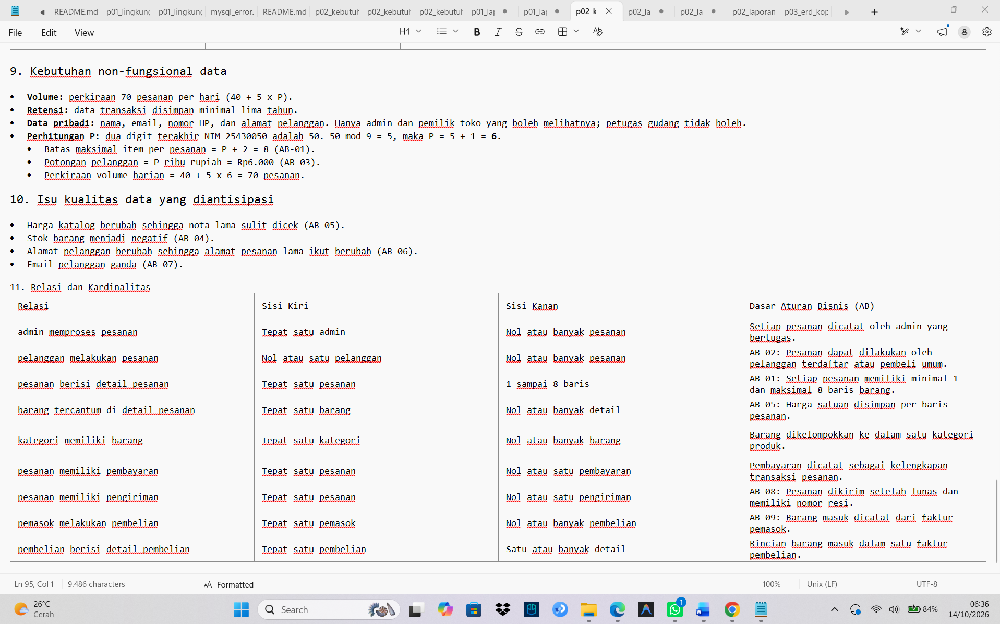

# Laporan Praktikum Basis Data – Pertemuan 03

- **Nama:** Intan Aulia Nurwulan
- **NPM:** 25430050
- **Kelas:** B
- **Tanggal:** 14 Oktober 2026

---

## 1. Tujuan Praktikum

- Mengidentifikasi entitas, atribut, kunci, dan relasi dari dokumen kebutuhan data Koperasi Mahasiswa Sejahtera (Kopma).
- Menentukan kardinalitas setiap relasi berdasarkan aturan bisnis.
- Menggambar ERD konseptual Kopma di draw.io dengan notasi Crow's Foot yang memenuhi standar kelengkapan.
- Memvalidasi ERD terhadap kebutuhan informasi dengan menelusuri jalur entitas untuk menjawab tiap KI.
- Meninjau dan memperbaiki ERD berdasarkan umpan balik pihak klien.
- Menganalisis keputusan perancangan, yaitu poin loyalitas sebagai atribut atau entitas riwayat, dan peran entitas asosiatif pada relasi banyak-ke-banyak.

## 2. Ringkasan Dasar Teori

ERD konseptual menggambarkan entitas, atribut, dan relasi antarentitas tanpa menetapkan tipe data dan constraint. Kunci primer (PK) membedakan tiap baris secara unik, sedangkan kunci tamu (FK) merujuk ke kunci primer entitas lain. Kardinalitas (1, 0..1, 0..N, 1..N) menyatakan jumlah baris yang berhubungan antarentitas, diturunkan dari aturan bisnis. Relasi banyak-ke-banyak dipecah dengan entitas asosiatif yang juga menyimpan atribut relasinya. ERD divalidasi dengan menelusuri jalur untuk menjawab tiap kebutuhan informasi, lalu ditinjau oleh klien.

## 3. Hasil Langkah Percobaan

*Gambar 1. ERD konseptual Kopma di draw.io.*

### Catatan tinjauan klien

1. "Tabel `pembelian` belum memiliki status. Di Kopma, barang dipesan terlebih dahulu lalu diterima kemudian, sehingga tidak dapat membedakan pesanan yang masih menunggu dan yang sudah masuk gudang. Mohon ditambahkan atribut status pembelian."
   - **Keputusan:** Diterima.
   - **Alasan:** pemesanan (PB-03) dan penerimaan barang (PB-04) adalah dua tahap berbeda, jadi atribut `status_pembelian` ditambahkan di tabel `pembelian`.
2. "Tabel `anggota` belum mencatat tanggal pendaftaran. Untuk laporan bulanan, perlu diketahui jumlah anggota baru setiap bulan. Mohon ditambahkan atribut tanggal daftar anggota."
   - **Keputusan:** Diterima.
   - **Alasan:** dibutuhkan untuk laporan anggota baru per bulan, jadi `tgl_daftar_anggota` ditambahkan di tabel `anggota`.

## 4. Jawaban Titik Analisis

### Titik Analisis 1

`id_anggota` tetap dipakai jadi kunci primer karena pendek, tidak berubah-ubah, dan tidak punya arti di dunia nyata. `no_anggota` dan `nim_anggota` cukup jadi kunci alternatif.

Risikonya kalau NIM dijadikan kunci primer: NIM bisa salah ketik dan perlu dikoreksi. Kalau nilainya berubah, semua kunci tamu yang nyambung ke NIM itu ikut harus diubah. NIM juga data pribadi, jadi ikut kesebar ke tabel lain.

### Titik Analisis 2

Aturan bisnis yang maksa: **AB-01**, setiap nota minimal punya satu baris barang.

Aturan ini tidak bisa dijaga sama struktur tabel aja. PK dan FK cuma memastikan detail nyambung ke penjualan yang ada, tapi tidak mencegah penjualan dibuat tanpa detail. Baru bisa dijaga lewat transaksi (Modul 14).

### Titik Analisis 3

ERD yang sekarang belum bisa jawab. `pembelian` cuma nyambung ke `pemasok`, tidak ke petugas gudang.

Yang perlu ditambah: relasi `petugas` 1 → 0..N `pembelian`, dengan FK `id_petugas` di tabel `pembelian`.

Perlu dicatat jadi aturan bisnis baru? Iya. Contohnya: "Setiap pembelian diterima tepat satu petugas berperan gudang." Aturan ini mengubah ERD dan ada batasan peran yang tidak bisa dijaga struktur tabel aja.

## 5. Hasil Latihan dan Modifikasi

### Latihan 1: Poin loyalitas

Poin cukup dijadikan atribut, tidak perlu entitas riwayat. Poin hanya berubah lewat nota, dan tiap nota sudah mencatat `poin_diperoleh_penjualan` dan `poin_ditukar_penjualan` beserta tanggalnya, jadi riwayatnya sudah ada di `penjualan`. `saldo_poin_anggota` di `anggota` cukup untuk KI-05, sedangkan KI-06 bisa dijawab dari `penjualan`. Entitas riwayat baru diperlukan hanya kalau poin bisa berubah di luar nota, dan di Kopma tidak ada aturan seperti itu.

### Latihan 2: Relasi penjualan–barang banyak-ke-banyak langsung

*Gambar 2. ERD Kopma dengan relasi penjualan–barang banyak-ke-banyak langsung, tanpa entitas asosiatif `detail_penjualan`.*

Tanpa `detail_penjualan`, atribut `qty_detail_penjualan` dan `harga_satuan_detail_penjualan` tidak punya tempat penyimpanan.

## 6. Tugas Mandiri: Milestone Proyek 03

*Gambar 3. ERD konseptual proyek Toko Larosa IAN.*

*Gambar 4. Tabel relasi dan kardinalitas proyek Toko Larosa IAN beserta kode aturan bisnis (AB).*

Terdapat dua entitas asosiatif dengan atribut sendiri:

- `detail_pesanan`, yang menghubungkan `pesanan` dan `barang`, dengan atribut `qty_detail_pesanan` dan `harga_satuan_detail_pesanan`.
- `detail_pembelian`, yang menghubungkan `pembelian` dan `barang`, dengan atribut `qty_detail_pembelian` dan `harga_beli_detail_pembelian`.

**Tabel 1. Penelusuran KI terhadap jalur ERD proyek Toko Larosa IAN**

| KI | Kebutuhan informasi | Jalur di ERD |
|---|---|---|
| KI-01 | Omzet dan jumlah pesanan per hari dan per bulan | `pesanan` → `detail_pesanan` |
| KI-02 | Lima barang terlaris per bulan berdasarkan qty | `pesanan` → `detail_pesanan` → `barang` |
| KI-03 | Barang dengan stok di bawah batas minimum | `barang` (`stok_barang` dibandingkan `batas_minimum_stok`) |
| KI-04 | Sepuluh pelanggan dengan belanja terbesar per bulan | `pelanggan` → `pesanan` → `detail_pesanan` |
| KI-05 | Pesanan yang sudah dibayar tetapi belum dikirim | `pesanan` → `pembayaran` (status lunas) dan `pesanan` → `pengiriman` (belum ada baris pengiriman) |
| KI-06 | Riwayat pembelian barang per pemasok | `pemasok` → `pembelian` → `detail_pembelian` → `barang` |

## 7. Pembahasan dan Kendala

### Pembahasan

ERD Kopma terdiri dari delapan entitas dan tujuh relasi, dengan kardinalitas yang diturunkan dari aturan bisnis. Keenam KI dapat ditelusuri lewat ERD, sehingga tidak ada entitas, atribut, atau relasi yang kurang. Pada latihan, poin loyalitas cukup menjadi atribut karena perubahan poin hanya terjadi lewat nota. Tanpa entitas asosiatif `detail_penjualan`, jumlah barang dan harga saat transaksi tidak punya tempat penyimpanan. ERD proyek Toko Larosa IAN terdiri dari sebelas entitas dengan dua entitas asosiatif, dan keenam KI-nya juga dapat ditelusuri.

### Kendala

1. Warna badan tabel di draw.io harus diatur lewat gaya tabel.
2. Simbol Crow's Foot dan label angka harus dipasang manual di setiap garis.
3. Ada salah penulisan nama tabel dan kolom yang diperbaiki setelah pengecekan.

## 8. Kesimpulan

ERD konseptual Kopma dan proyek Toko Larosa IAN berhasil digambar di draw.io sesuai standar kelengkapan, yaitu entitas, atribut, kunci, kardinalitas, garis relasi, dan legend. Kardinalitas relasi diturunkan dari aturan bisnis, dan seluruh kebutuhan informasi dapat ditelusuri lewat ERD, sehingga tidak ada entitas, atribut, atau relasi yang kurang. Entitas asosiatif diperlukan untuk menyimpan jumlah barang dan harga saat transaksi pada relasi banyak-ke-banyak. Tinjauan klien membantu menemukan atribut yang masih kurang sebelum perancangan dilanjutkan.

## 9. Pernyataan Penggunaan AI

Dalam praktikum Modul 3 ini, saya menggunakan Claude (Anthropic) untuk menjelaskan perintah praktikum, memeriksa ERD terhadap standar kelengkapan, dan membantu menyusun draf teks laporan. Seluruh ERD saya gambar sendiri di draw.io. Hasil dari AI saya periksa dan sesuaikan dengan dokumen kebutuhan data dan buku praktikum sebelum dimasukkan ke laporan, dan saya bertanggung jawab atas isinya.

## 10. Bukti Git

- **Repositori:** <https://github.com/intanauliaaja-cyber/basisdata_25430050>
- **Pesan commit:** `p03: laporan modul 3`
