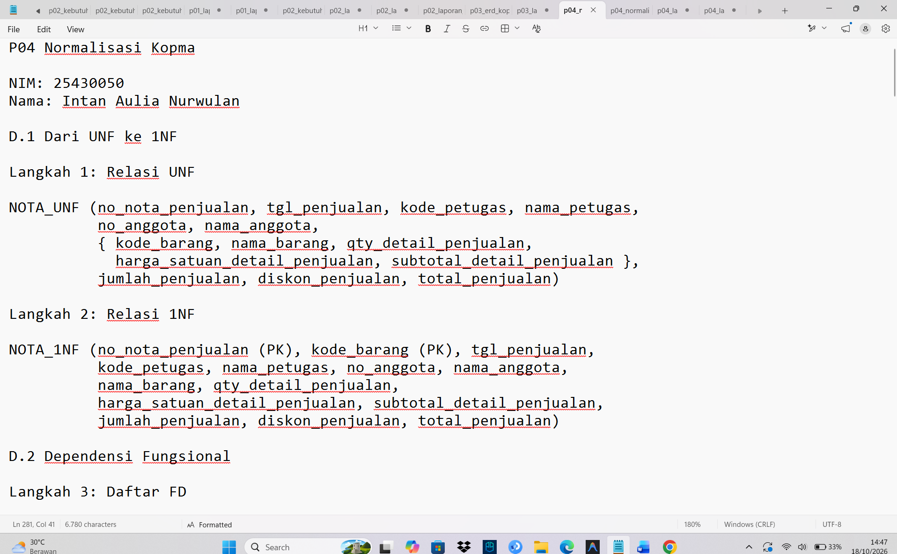
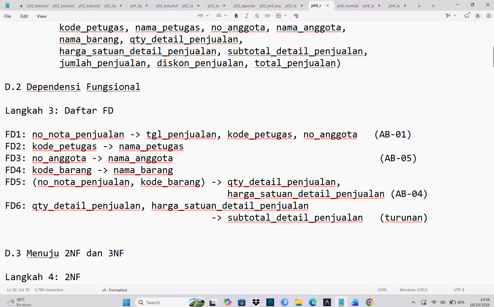
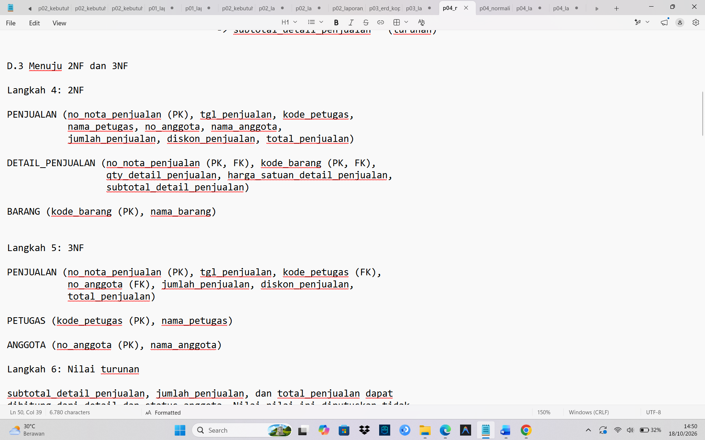

# Laporan Praktikum Basis Data – Pertemuan 04

- **Nama:** Intan Aulia Nurwulan
- **NPM:** 25430050
- **Kelas:** B
- **Tanggal:** 18 Oktober 2026

---

## 1. Tujuan Praktikum

- Menormalisasi nota penjualan Kopma dari bentuk tidak normal (UNF) sampai 3NF.
- Mengidentifikasi dependensi fungsional (FD) dari aturan bisnis.
- Memutuskan nilai turunan disimpan atau dihitung, beserta alasannya.
- Membandingkan hasil normalisasi dengan skema kanonik dan memeriksa BCNF.
- Menerapkan normalisasi pada proyek mandiri (Toko Larosa IAN).

## 2. Ringkasan Dasar Teori

- **UNF:** relasi yang masih memuat kelompok berulang.
- **1NF:** semua nilai atomik dan tidak ada kelompok berulang.
- **2NF:** memenuhi 1NF dan tidak ada dependensi parsial.
- **3NF:** memenuhi 2NF dan tidak ada dependensi transitif.
- **BCNF:** setiap penentu dalam sebuah FD harus berupa kunci kandidat.
- **Dependensi fungsional (`A -> B`):** nilai A menentukan nilai B.
- **Nilai turunan:** nilai yang dapat dihitung dari atribut lain.

## 3. Hasil Langkah Percobaan

### 3.1 Dari UNF ke 1NF



*Gambar 1. Langkah 1-2: relasi `NOTA_UNF` dan `NOTA_1NF`*

### 3.2 Dependensi fungsional



*Gambar 2. Langkah 3: daftar dependensi fungsional FD1–FD6*

### 3.3 Menuju 2NF dan 3NF



*Gambar 3. Langkah 4-5: relasi hasil 2NF dan 3NF*

### 3.4 Mencocokkan dengan skema kanonik

| Tahap | Relasi hasil | Masalah yang diselesaikan |
| --- | --- | --- |
| UNF | `NOTA_UNF` (grup berulang barang) | Barang berulang dalam satu nota |
| 1NF | `NOTA_1NF` (PK: `no_nota_penjualan`, `kode_barang`) | Grup berulang dihapus; setiap sel atomik |
| 2NF | `PENJUALAN`, `DETAIL_PENJUALAN`, `BARANG` | Dependensi parsial: `tgl_penjualan`, petugas, anggota hanya bergantung pada nota; `nama_barang` hanya bergantung pada `kode_barang` |
| 3NF | `PENJUALAN`, `DETAIL_PENJUALAN`, `BARANG`, `PETUGAS`, `ANGGOTA` | Dependensi transitif: `nama_petugas` lewat `kode_petugas`, `nama_anggota` lewat `no_anggota` |

## 4. Jawaban Titik Analisis

### Daftar dependensi fungsional

| No | Dependensi fungsional | Dasar |
| --- | --- | --- |
| FD1 | `no_nota_penjualan -> tgl_penjualan, kode_petugas, no_anggota` | AB-01 |
| FD2 | `kode_petugas -> nama_petugas` | - |
| FD3 | `no_anggota -> nama_anggota` | AB-05 |
| FD4 | `kode_barang -> nama_barang` | - |
| FD5 | `(no_nota_penjualan, kode_barang) -> qty_detail_penjualan, harga_satuan_detail_penjualan` | AB-04 |
| FD6 | `qty_detail_penjualan, harga_satuan_detail_penjualan -> subtotal_detail_penjualan` | Turunan |

### Keputusan nilai turunan

| Nilai turunan | Keputusan | Alasan |
| --- | --- | --- |
| `subtotal_detail_penjualan` | Dihitung | Hasil qty × harga satuan (FD6); jika disimpan bisa berbeda dari qty dan harga |
| `jumlah_penjualan` | Dihitung | Jumlah seluruh subtotal pada satu nota |
| `diskon_penjualan` | Dihitung | Bergantung pada jumlah dan status anggota aktif (5%, AB-02) |
| `total_penjualan` | Dihitung | Jumlah dikurangi diskon |

### Titik Analisis 1

Karena harga pada nota adalah harga saat transaksi terjadi, dan barang yang sama bisa terjual dengan harga berbeda di nota yang berbeda (AB-04). Jika harga dipindah ke tabel `barang`, setiap kenaikan harga ikut mengubah nota lama, sehingga omzet tahun lalu menjadi salah.

### Titik Analisis 2

Pada tabel operasional, data masih bisa berubah, jadi total dihitung agar selalu sesuai dengan datanya. Pada tabel arsip, data sudah menjadi catatan historis yang tidak boleh berubah, jadi total boleh disimpan agar nilainya tetap. Keduanya konsisten karena nilai turunan hanya disimpan bila datanya sudah tidak berubah.

### Titik Analisis 3

Informasinya disimpan pada tabel `pembelian` dan `detail_pembelian`, yang terhubung ke tabel `pemasok`. Keuntungannya: satu barang bisa punya banyak pemasok, data pemasok tersimpan sekali saja sehingga mudah diubah, dan riwayat pembelian tetap tercatat.

## 5. Hasil Latihan dan Modifikasi

### E.1 Beberapa nomor telepon untuk setiap pemasok

Jika satu pemasok diizinkan mempunyai beberapa nomor, `telepon_pemasok` menjadi atribut bernilai banyak dan melanggar 1NF.

```text
PEMASOK_UNF (id_pemasok, nama_pemasok, alamat_pemasok, { telepon_pemasok })
PEMASOK_1NF (id_pemasok (PK), telepon_pemasok (PK), nama_pemasok, alamat_pemasok)
```

Pada 2NF, `nama_pemasok` dan `alamat_pemasok` hanya bergantung pada sebagian kunci (`id_pemasok`), sehingga dipisah. Tidak ada dependensi transitif tersisa, jadi 3NF terpenuhi.

```text
PEMASOK (id_pemasok (PK), nama_pemasok, alamat_pemasok)
TELEPON_PEMASOK (id_pemasok (PK, FK), no_telepon_pemasok (PK))
```

### E.2 Contoh data yang melanggar 3NF

Andaikan `nama_anggota` disimpan di tabel `PENJUALAN`. Terjadi rantai `no_nota_penjualan -> no_anggota -> nama_anggota`, sehingga `nama_anggota` (bukan kunci) bergantung pada `no_anggota` (bukan kunci).

| no_nota_penjualan | tgl_penjualan | kode_petugas | no_anggota | nama_anggota |
| --- | --- | --- | --- | --- |
| PJ-2609-0001 | 2026-09-01 | P01 | A-001 | Budi Santoso |
| PJ-2609-0002 | 2026-09-03 | P01 | A-001 | Budi Santoso |
| PJ-2609-0003 | 2026-09-05 | P02 | A-001 | Budi Santoso |

**Anomali ubah:** nama diubah hanya pada satu nota.

```sql
UPDATE penjualan
SET nama_anggota = 'Budi Santosa'
WHERE no_nota_penjualan = 'PJ-2609-0001';

SELECT no_anggota, COUNT(DISTINCT nama_anggota) AS jumlah_nama
FROM penjualan
GROUP BY no_anggota
HAVING COUNT(DISTINCT nama_anggota) > 1;
```

Hasilnya anggota A-001 punya dua nama berbeda. Jika `nama_anggota` hanya disimpan di tabel `ANGGOTA`, cukup satu baris yang diubah.

## 6. Tugas Mandiri: Milestone Proyek 04

- **Proyek:** Toko Larosa IAN (toko batik)
- **Dokumen sumber:** Nota Penjualan fiktif Toko Larosa IAN

### Tabel tahapan UNF → 1NF → 2NF → 3NF

| Tahap | Relasi | Yang dilakukan |
| --- | --- | --- |
| UNF | `NOTA_UNF` | Grup berulang barang di dalam `{ }` |
| 1NF | `NOTA_1NF` (PK: `no_pesanan`, `kode_barang`) | Satu baris per barang per pesanan |
| 2NF | `PESANAN`, `DETAIL_PESANAN`, `BARANG` | Atribut yang hanya bergantung pada `no_pesanan` atau `kode_barang` dipisah |
| 3NF | `PESANAN`, `DETAIL_PESANAN`, `BARANG`, `KATEGORI`, `ADMIN`, `PELANGGAN`, `PEMBAYARAN`, `PENGIRIMAN` | Rantai `no_pesanan -> kode_admin -> nama_admin` dan `no_pesanan -> kode_pelanggan -> nama_pelanggan` dipisah |

### Daftar dependensi fungsional proyek

| FD | Dependensi | Dasar |
| --- | --- | --- |
| FD1 | `no_pesanan -> tanggal_jam_pesanan, kode_admin, kode_pelanggan, alamat_tujuan_pesanan, ongkos_kirim_pesanan, potongan_pesanan` | AB-01, AB-03, AB-06 |
| FD2 | `kode_admin -> nama_admin` | Kamus data |
| FD3 | `kode_pelanggan -> nama_pelanggan` | AB-02, AB-07 |
| FD4 | `kode_barang -> nama_barang` | Kamus data |
| FD5 | `(no_pesanan, kode_barang) -> qty_detail_pesanan, harga_satuan_detail_pesanan` | AB-01, AB-05 |
| FD6 | `qty_detail_pesanan, harga_satuan_detail_pesanan -> subtotal_detail_pesanan` | Turunan |
| FD7 | `no_pesanan -> metode_pembayaran, status_pembayaran` | AB-08 |
| FD8 | `no_pesanan -> no_resi_pengiriman` | AB-08 |
| FD9 | `no_pesanan -> jumlah_pesanan, total_pesanan` | Turunan |

### Keputusan nilai turunan

| Nilai | Cara menghitung | Keputusan | Alasan |
| --- | --- | --- | --- |
| `subtotal_detail_pesanan` | qty × harga satuan | Tidak disimpan | Dapat dihitung dari detail pesanan |
| `jumlah_pesanan` | Jumlah seluruh subtotal | Tidak disimpan | Dapat dihitung dari detail pesanan |
| `total_pesanan` | Jumlah − potongan + ongkos kirim | Tidak disimpan | Dapat dihitung. Contoh PS-2610-0031: 555.000 − 6.000 + 18.000 = 567.000 |
| `potongan_pesanan` | - | Disimpan | Nilai potongan tiap pesanan harus tetap walau aturan potongan (AB-03) berubah |
| `ongkos_kirim_pesanan` | - | Disimpan | Ditetapkan per pesanan (AB-06) |
| `jumlah_bayar` | - | Disimpan | Mencatat uang yang benar-benar dibayarkan, bukan hasil hitung |

### Perubahan ERD proyek

| No | Bagian ERD | Sebelum | Sesudah | Alasan |
| --- | --- | --- | --- | --- |
| 1 | `admin`, kunci primer | `id_pelanggan` | `id_admin` | Nama kunci primer tertukar dengan tabel `pelanggan`; kunci tamu di `pesanan` sudah `id_admin` |
| 2 | `pelanggan`, `kode_pelanggan` | `CHAR(6)` | `CHAR(7)` | Format PL-0123 terdiri dari 7 karakter |
| 3 | `pembayaran`, jumlah bayar | `jumlah bayar` | `jumlah_bayar` | Nama kolom tidak boleh berspasi; sesuai kamus data |
| 4 | `pembayaran.id_pesanan` dan `pengiriman.id_pesanan` | Tanpa `UNIQUE` | Ditambah `UNIQUE` | Satu pesanan paling banyak satu pembayaran dan satu pengiriman (FD7, FD8, AB-08) |
| 5 | Relasi `pelanggan` dan `pesanan` | Sisi pelanggan 0..1; `id_pelanggan` opsional | Sisi pelanggan 1; `id_pelanggan` wajib | AB-02: pesanan hanya dari pelanggan terdaftar yang aktif |
| 6 | `pemasok` | Tanpa `kode_pemasok` | Ditambah `kode_pemasok VARCHAR(10) UNIQUE` | Ada di kamus data dan dokumen kebutuhan data |
| 7 | `pembayaran` | Tanpa `tanggal_bayar` | Ditambah `tanggal_bayar DATE` | Ada di entitas Pembayaran pada dokumen kebutuhan data |
| 8 | `pengiriman` | Tanpa `kurir` dan `tanggal_kirim` | Ditambah `kurir VARCHAR(50)` dan `tanggal_kirim DATE` | Ada di entitas Pengiriman pada dokumen kebutuhan data |

## 7. Pembahasan dan Kendala

**Pembahasan:** langkah normalisasi UNF sampai 3NF pada nota Kopma, hasil lima tabel yang memenuhi BCNF, dan alasan nilai turunan tidak disimpan. Ada satu kalimat tentang proyek Toko Larosa IAN.

**Kendala:**

- Menentukan nilai turunan mana yang disimpan atau dihitung.
- Membedakan pemisahan tabel yang wajib menurut 3NF dengan keputusan desain.
- Menyesuaikan ERD proyek dengan hasil normalisasi.

## 8. Kesimpulan

- Normalisasi membuat data lebih rapi: data yang berulang dipisah ke tabel sendiri, sampai nota Kopma menjadi lima tabel yang memenuhi 3NF dan BCNF.
- Dependensi fungsional membantu menentukan kunci dan cara memecah tabel.
- Nilai turunan seperti subtotal dan total tidak disimpan, cukup dihitung, supaya datanya tidak saling bertentangan.
- Harga satuan tetap disimpan di setiap nota supaya nota lama tidak ikut berubah saat harga naik.
- Cara yang sama dipakai pada proyek Toko Larosa IAN.

## 9. Pernyataan Penggunaan AI

Saya menggunakan Claude (Anthropic) untuk membantu menyusun laporan ini, yaitu:

- membuat kerangka laporan sesuai templat buku;
- menulis draf keterangan gambar, jawaban Titik Analisis, pembahasan, kendala, dan kesimpulan;
- mengecek kesalahan penulisan pada berkas normalisasi saya.

## 10. Bukti Git

- **Repositori:** <https://github.com/intanauliaaja-cyber/basisdata_25430050>
- **Pesan commit:** `p04: laporan`
