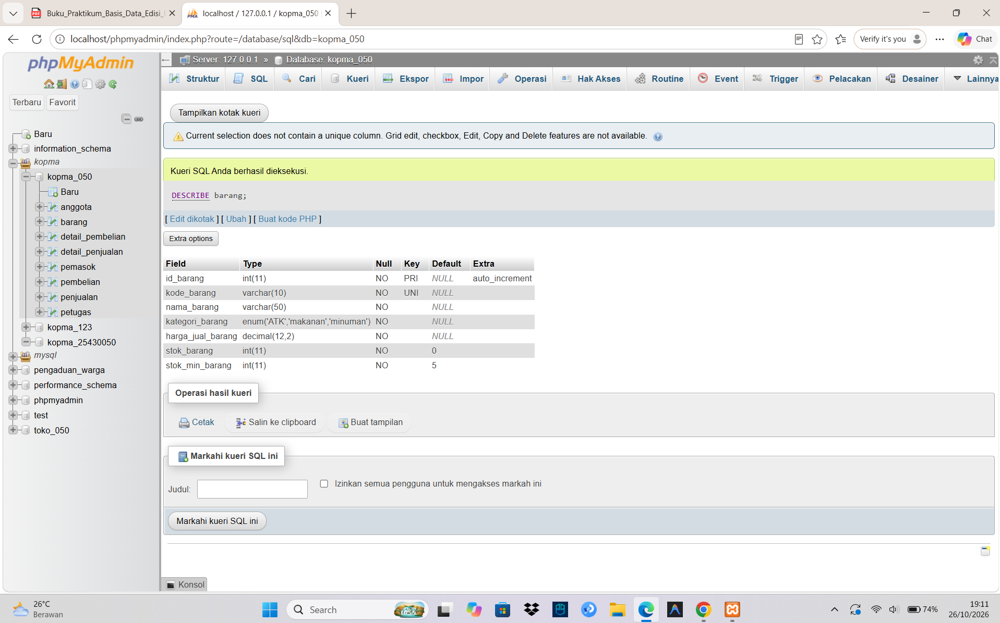
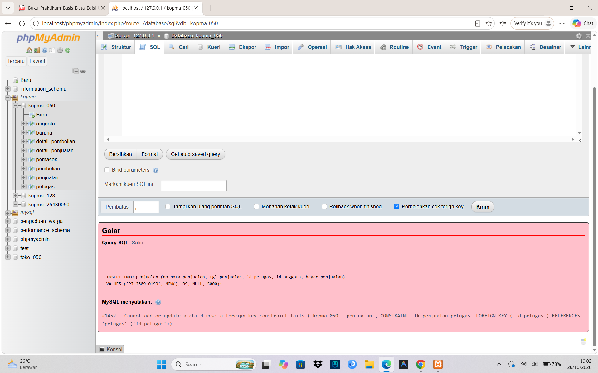
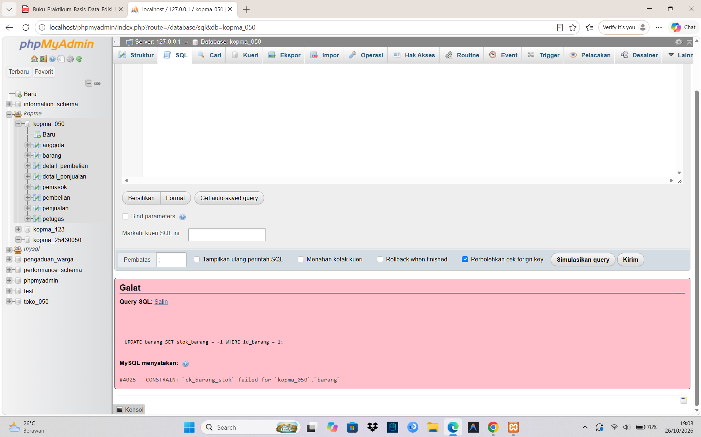
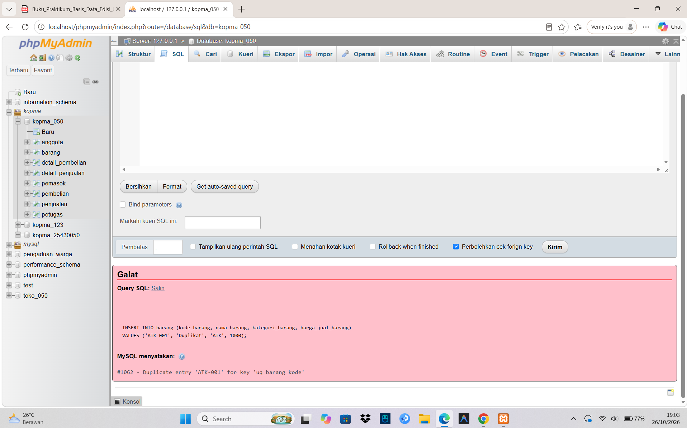

Laporan Praktikum Basis Data - Pertemuan 05
Nama: Intan Aulia Nurwulan   NIM: 25430050   Kelas: B   Tanggal: 27 Oktober 2026

1. Tujuan Praktikum

- mengimplementasikan physical data mode (ERD fisik) ke dalam skrip SQL ddl yang bersifat idempotent.
- menerapkan urutan DROP TABLE IF EXISTS dan CREATE TABLE yang benar dari table anak ke induk untuk menghindari galat Foreign Key 
- mengimplementasikan constraint integrity data

2. ringkasan dasar teori 

Data Definition Language (DDL) adalah perintah SQL seperti CREATE, ALTER, dan DROP untuk membuat dan mengatur struktur tabel dalam basis data. Pembuatan tabel menggunakan tipe data yang sesuai (seperti INT, VARCHAR, DECIMAL, dan ENUM) serta batas aturan (constraint) seperti Primary Key, Foreign Key, Unique, Not Null, Default, dan Check untuk menjaga agar data tetap valid. Agar skrip DDL berjalan lancar tanpa error, pembuatan tabel dimulai dari tabel induk ke tabel anak, sedangkan penghapusan tabel dilakukan sebaliknya dari tabel anak ke tabel induk.

3. Hasil Langkah Percobaan

3.1 Pemeriksaan Struktur Tabel Utama dengan SHOW CREATE TABLE

*Gambar 1. Tampilan perintah `SHOW CREATE TABLE barang`*

3.2 Pengujian Pelanggaran Constraint (FK dan CHECK)

4. Jawaban Titik Analisis 

Titik Analisis 1
ON DELETE CASCADE pada detail penjualan vs barang: detail_penjualan memakai Cascade karena rincian pesanan wajib ikut terhapus jika nota utamanya dihapus. Sebaliknya, detail_barang tidak memakai Cascade untuk melindungi data master barang agar tidak terhapus tidak sengaja.Akibat jika barang boleh dihapus beserta detailnya: Data riwayat transaksi masa lalu akan hilang atau rusak, sehingga laporan omzet dan audit historis menjadi tidak akurat.

Titik Analisis 2
Pemetaan Kode Galat ke Aturan Bisnis (AB-xx):Galat 1452 (Foreign Key): Melindungi aturan AB-02 (pelanggan/admin/barang harus terdaftar).Galat 4025 (Check): Melindungi aturan AB-04 (stok tidak boleh negatif).Galat 1062 (Unique): Melindungi aturan AB-01 / AB-07 (nomor nota/email harus unik).Aturan yang belum bisa dijaga constraint: Aturan bisnis yang kompleks seperti batas maksimal item per pesanan ($P+2$, yaitu 8 item) atau kalkulasi bertingkat.

Titik Analisis 3
Mengapa harus mulai dari tabel anak: Karena tabel anak (detail) terikat oleh kunci tamu (foreign key) ke tabel induk. Tabel anak wajib dihapus terlebih dahulu sebelum tabel induknya.Pesan galat jika dibalik: Muncul galat ERROR 1217 / 1451 karena basis data menolak menghapus tabel induk yang masih memiliki relasi aktif dengan tabel anak.

5. Hasil Latihan dan Modifikasi

E.1 Constraint UNIQUE untuk Email Pelanggan (AB-07)
Memastikan email tidak boleh sama antar pelanggan.SQLALTER TABLE pelanggan
ADD CONSTRAINT uq_pelanggan_email UNIQUE (email_pelanggan);
Galat saat duplikat: ERROR 1062 (23000)
E.2 Constraint CHECK untuk Batas Minimum StokMemastikan batas minimum stok barang tidak boleh negatif.SQLALTER TABLE barang
ADD CONSTRAINT ck_barang_min_stok CHECK (batas_minimum_stok >= 0);
Galat saat bernilai negatif ($< 0$): ERROR 4025 (23000): CONSTRAINT 'ck_barang_min_stok' failed

6. Tugas Mandiri : Milestone Proyek 5

Proyek: Toko Larosa IAN (Toko Daring)
Basis Data: toko_050 (Charset: utf8mb4_unicode_ci)
NIM / P: 25430050 / P=6

Ringkasan Implementasi DDL dan ERD Fisik
Skrip DDL p05_ddl_25430050.sql dan ERD fisik p05_erd_fisik_25430050.drawio dirancang untuk membangun seluruh struktur tabel basis data Toko Larosa IAN secara lengkap dan idempotent.
Tabel yang diimplementasikan terdiri dari:
Tabel Master/Induk: admin, pelanggan, kategori, barang, pemasok.
Tabel Transaksi/Anak: pesanan, detail_pesanan, pembayaran, pengiriman, pembelian, detail_pembelian.
Penerapan Aturan Bisnis (AB-01 s.d. AB-09) ke dalam Constraint:
Primary Key & Auto Increment: Digunakan pada seluruh ID utama tabel 
Unique Constraint: Mencegah duplikasi data pada kolom unik seperti kode_admin, email_pelanggan, no_pesanan, dan no_resi_pengiriman.
Foreign Key & Cascade: Menghubungkan tabel induk dan anak (misalnya relasi pesanan dengan detail_pesanan menggunakan ON DELETE CASCADE).
Check Constraint: Memastikan nilai numerik valid, seperti stok_barang >= 0 dan harga/jumlah tidak bernilai negatif.
Default Constraint: Memberikan nilai bawaan otomatis seperti status aktif, tanggal, atau nilai ongkir/potongan awal.

7. Pembahasan dan Kendala

Pembahasan: Implementasi PDM ke dalam skrip DDL SQL toko_050 berjalan lancar. Struktur relasi master-detail berhasil dibuat dengan urutan yang tepat sehingga bebas dari galat kunci asing (foreign key error). Seluruh constraints (Primary Key, Foreign Key, Unique, Check, dan Default) juga terpasang dengan baik untuk menegakkan aturan bisnis proyek Toko Larosa IAN.
Kendala: Menyesuaikan penamaan constraint secara konsisten dan memastikan presisi tipe data desimal untuk harga serta tipe tanggal/waktu agar sesuai dengan kebutuhan transaksi daring.

8. Kesimpulan 

Skrip DDL p05_ddl_25430050.sql berhasil dibuat dan dapat dijalankan ulang dengan lancar dari basis data kosong tanpa galat kunci asing.
Penerapan berbagai constraints (Primary Key, Foreign Key, Unique, Check, dan Default) terbukti efektif dalam menjaga validitas, konsistensi, serta integritas data sesuai aturan bisnis pada proyek Toko Larosa IAN.

9. Pernyataan Penggunaan AI
Dalam penyusunan laporan praktikum Modul 05 ini, saya menggunakan bantuan Gemini (Google AI) sebagai asisten untuk membimbing penyusunan kerangka laporan, merapikan format teks agar sesuai panduan, serta memverifikasi jawaban analisis dan skrip DDL SQL. Seluruh proses pengujian constraint, perancangan ERD, dan eksekusi basis data tetap dipahami dan divalidasi secara mandiri.

10. Bukti Git
Repositori: https://github.com/intanauliaaja-cyber/basisdata_25430050
Pesan commit: `p05: laporan`